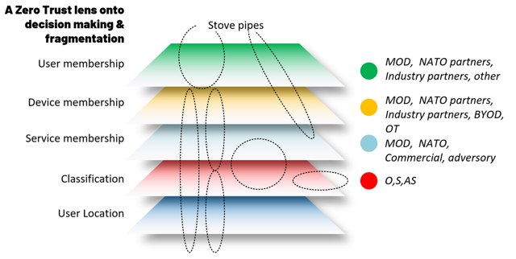
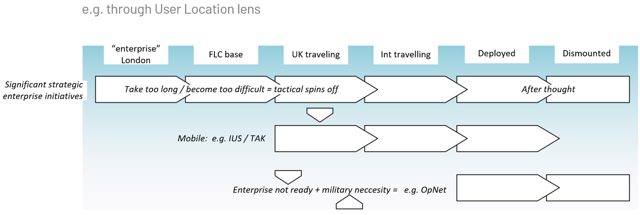
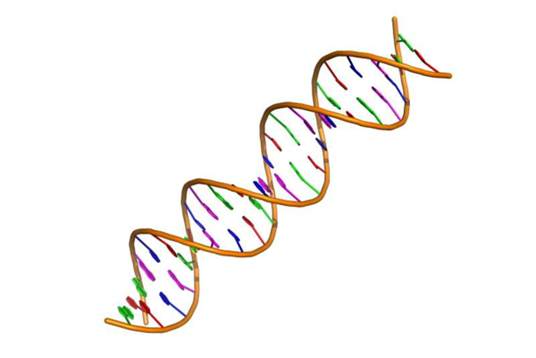
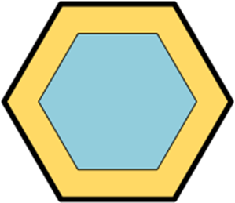
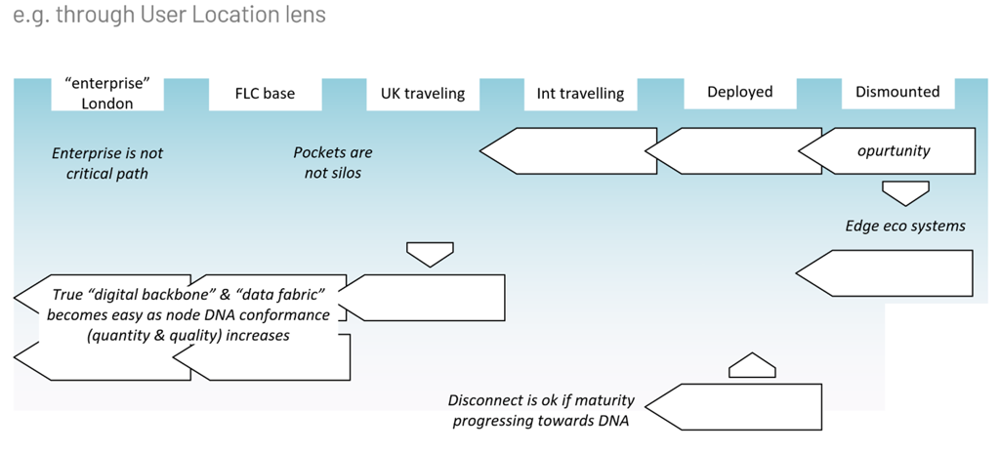
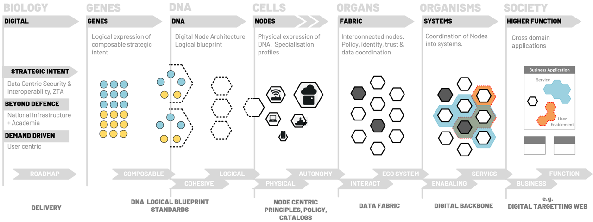

# Biologically Digital - an introduction to DNA

**DNA: Digital Node Architecture**
A thought experiment, starting with the smallest things and letting them shape the difficult things.  The essence of strategic intent as expressed through a DCS&I & military resilience utopian vision.  Is now the time to consider this beyond technology into the ramifications on us, our culture and how we nurture & celebrate innovation at the edge?  Furthermore, that London and the enterprise learns to become comfortable being shaped by this federated demand, not a master over it.

> [!TIP]
> **TLDR**:  ✅ skip to the two diagrams at the bottom.  [DNA: starting with the smallest things](#dna-starting-with-the-smallest-things) 

---

## Setting the scene - vision

Challenging every convention for what it means to be & do digital.  This is not a programme or interested in defining solutions or delivering specific technology.

> [!NOTE]
> **DNA**: Both business & technical resilience expressed through decentralised agency to innovate & progress digital technology whilst nurturing a productive & positive tension towards enterprise strategic goals.

> [!TIP]
> **Technology mimicking life and biology**,  starting with the smallest autonomous cells, encouraging mutations across a federated landscape and as a consequence, the gradual maturing of a fabric and composition into resultant systems (organs & organisms).

## The challenge - beyond technology

How to avoid an allergic reaction / not letting our current selves constrain our thinking ?

> [!CAUTION]
> ❌ This is not about “a solution” or a single prescribed answer.  This is not yet about who.

This is about stepping outside the institutional constrained thinking to imagine technology and a future enabling service portfolio harmonious to every use case from war fighter to core enterprise.  **The celebration of peer to peer autonomy**, the acceptance of **pockets of innovation with technology agency at the edge** and the gradual emergence of a fabric including what this means to governance, operating models and culture.

> [!WARNING]
> ❌ The very structure of the current MOD response to digital & to being an enterprise is in many ways a hinderance to allowing a necessary step change in digital maturity.   Achieving the SDR goals requires digital to be part of everything,  not a ring-fenced capability or organisation unit.

Painting a picture of a possible **composable logical** technical blueprint(?) will help us stress test this and understand how we need to disrupt and transform ourselves.

---

## Key problems

> [!IMPORTANT]
> **Context**:  This section and articulation of the problems was originally created using the singular context of *how to enable users to become consumers of services and all the related enabling services and technology*.  However as a concept it **applies to all contexts involving people, process & technology**.

### *How to destroy the existing silos & barriers ?*
- Across technology and services
- Across classifications, organisations & locations
- Between enterprise scale and frontline specific contexts
- Between difficult strategic mobilisation and urgent tactical response.

> [!WARNING]
> ❌ Massive overheads and risk from debt; business fragmentation & technology obsolescence

### *How to prevent future silos & barriers ?*
*Typical **strategic** technology adoption: from back to front line, enterprise to tactical edge.*
> [!CAUTION]
> ❌ Our instinct is to reach for big programmes,  contracts,  partners.  We try to prescribe architectures out from London towards the edge.

> [!WARNING]
> ❌ Critical path & overly prescribed delivery = broken resilience ?  Fragmentation in practise ?

---

## Inspiration

### *Turn it on its head,  celebrate pockets*
> [!NOTE]
> Q:  **What is a resilience utopia ?**
>
> A:  **Decentralised agency to progress & innovate technology ?**

| Where have we seen this before? |  | **Inspiration from Biology  ** **Genes & DNA** contain the design blueprint critical to the formation of cells, organs, and organisms **all** *"in the image"* of the DNA.  Mutations are a good thing. . |
| :--- | :--- | :--- |

> [!TIP]
> ✅ **Don't start with the big things, start with the smallest things**

> [!WARNING]
> ❌ *perhaps excluding quantum :)*

---

## What if ? *how can "digital" learn from biological DNA ?*

✅ Decentralised agency

✅ Everything is a **Digital**   ...it's all made of <s>stars</s> **Digital Nodes** 

> [!NOTE]
> - Servers
> - Devices in the hand
> - Network routers
> - Wifi APs 
> - kit in a tank
> - a satellite
> - anything anywhere....
>
> - ... that IoT circuit board on the back of the vending machine
>
> - ...including anything you don't own *(posture, risk appetite and ability to exploit for our own purposes)*

|  |  |  |
| :--- | :---: | :--- |
| ✅ SDR, Digital Backbone, and Data Fabric are requirements for all nodes to **share the same Digital DNA**.   ✅ Defence Reform & DIP demands a **reset of our relationship with digital across technology, process & people**  ✅ Q: **What are the genes in a digital world?**  A:**Strategy** |  | ❌ **Starting with enterprise systems** is an anti-pattern  ❌ **Massive critical path programmes** are an anti-pattern  ❌ **Massive or monolithic contracts or solutions** are an anti-pattern   ❌ Critical path consensus on, or **overly prescribed Reference Architectures** can be an anti-pattern |
| | ✅ Stand on the shoulders of data: DCA    ✅ and progressive cyber thinking: DCSI & ZT utopian aspirations | |

## What if ? *is mobilisation realistic ?*

**What is a resilience utopia ?**  *Decentralised agency to progress & innovate technology ?*

**What is an enterprise utopia ?**  *...whilst achieving strategic objectives !*

> [!TIP]
> ✅ The DNA shapes all nodes which in turn shape all systems & the enterprise

---

## Where this is resonating ?

### *Turning the arrows on their heads ~ edge shaping core*

> [!IMPORTANT]
> **General Sir Richard Barrons KCB CBE:**
> Strong parallel between SDR & BRAVE1,  its responding to the same demand.    "*it should not be about full warehouses;  it should be about the (meta) capability to change and evolve.*"

> [!IMPORTANT]
> **Admiral Sir Tony Radakin KCB (Defense Disrupted):**
> "*We can not do this with long conversations about far out concepts.*"
> "*We need to innovate fast now.*"

> [!IMPORTANT]
> **RedHat & Lockheed Martin** 
> prioritising the innovation & delivery of technology at the edge that then shapes the core enterprise.

> [!IMPORTANT]
> **CDW/HPE/NVIDIA:**
> Prioritise the war fighter use cases at the edge including ephemeral pockets and ownership of data & technology that best support relevant AI and later transitions to the core as urgency changes.

> [!IMPORTANT]
> **UKR >> BRAVE1:**
> Distributed empowerment of frontline units with direct relationship with technology vendors, not large, slow procurement chains prescribing out from the core. [Operational Innovation as a Service (OIaaS)](./operational-innovation-as-a-service-oiaas-learning-from-ukraines-innovation-model.md).
> 
> Almost a philosophy that the capability to tactically change is more important than the reality of any point in time; including the luxury of strategic targets. Becoming comfortable with diverse technologies within a shared strong **logical** goal = resilience.

---

## DNA: starting with the smallest things
*Mimic biology. micro shaping macro. DCSI+ZT as the kernel of everything.*

---

## DNA: Composable genes, DNA + Nodes

## Governance

### Decentralised innovation & traction

See companion document: [Operational Innovation as a Service (OIaaS) ~ Learning from Ukraine’s Innovation Model](./operational-innovation-as-a-service-oiaas-learning-from-ukraines-innovation-model.md)

### Policy -vs- Principles

> [!TODO]
> In the absence of a culture that uses **measurable principles**, MOD only ever reaches for policy in order to influence change. The nature of the complex organisation only employing policy leads to a complex policy landscape that mimics and even encourages fragmentation.
>
> **Actions:**
> - Add details of **measurable** principles.
> - Softer than black or white policy — so arguably more enduring.
> - Measurable for each Digital trait of DNA and/or genes.
> - Use to score anything and everything yearly at first and then quarterly later.
> - Develop a roadmap with maturity targets for the next 10 years for each principle. Programmes, services, or FLCs can earn credits for good scores.
