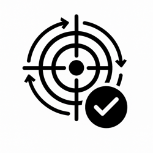
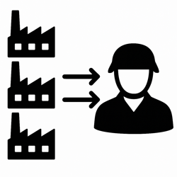
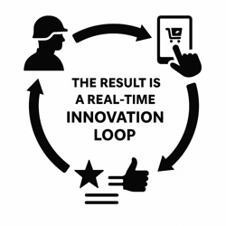

# Operational Innovation as a Service (OIaaS) ~ Learning from Ukraine’s Innovation Model

Ukraine has developed a ground-breaking approach to military innovation that blends **gamification, open-market dynamics, and decentralised decision-making** — a model born out of wartime necessity but rich with lessons for modern defence organisations.

Can this help in a back office of dysfunction & disconnected programmes, teams, architecture ?  Learning lessons in how to coordinate & incentivise enterprise or national interests in tension with decentralised agency.

## Introduction: Learning from Ukraine’s Innovation Model

Ukraine has developed a ground-breaking approach to military innovation that blends **gamification, open-market dynamics, and decentralised decision-making** — a model born out of wartime necessity but rich with lessons for modern defence organisations.

At the heart of this system is the **Brave 1 Market**, a digital platform described as an “Amazon for the military.” It allows Ukrainian units to earn points for operational success—such as confirmed drone strikes—and redeem those points for advanced technologies like AI-enabled drones, electronic warfare tools, and surveillance systems.

> [!TIP]
> What makes this model especially powerful is its   **feedback-driven, user-led structure**:

|  |  |  |  |
| --- | --- | --- | --- |
|  |  |  |  |
| ✅ **Points are only awarded when kills or strikes are independently confirmed,**   ensuring that rewards are tied to real-world impact. This confirmation process generates high-quality operational data that feeds back into R&D, procurement, and battlefield adaptation. | ✅ **Frontline units choose exactly what they need,**   based on their mission context and operational experience—not what is prescribed from above. | ✅ **They access technology directly from vendors**   through the marketplace, bypassing traditional, top-down procurement pipelines. | ✅ **They rate the performance of the tools they use,**   creating a transparent, peer-informed feedback loop that helps others make better decisions and drives continuous improvement among suppliers. |

|  |  |
| --- | --- |
|  | ✅ Frontline users are empowered to shape their own operational ecosystem.   ✅ Developers and suppliers are incentivised to build what works.   ✅ The system continuously learns and evolves based on operational data and user feedback. |

 

This model represents a **paradigm shift in how military capability is developed, delivered, and evolved**. It decentralises decision-making, accelerates innovation cycles, and ensures that those closest to the fight have the tools—and the agency—to adapt in real time.

**It offers a compelling blueprint for how any Ministry of Defence can reimagine the broader enterprise of operational innovation, including within digital service delivery.**

# Operational Innovation-as-a-Service (OIaaS)
> [!WARNING]
> *JUST BECAUSE YOU BUILD IT DOES NOT MEAN THEY WILL COME*
> **This is born out of** ...thinking about the currently failing feedback loops involved in the XXX XXX desire to promote reuse of architecture patterns and policy.
> Specifically where the resource constraints & disconnect exists across teams who could make patterns attractive for reuse versus the teams that should want to consume them. 
> This is discussed more elsewhere: 
> - *Top-down business decision making: How do we stimulate reuse now?*
> - *Top-down business decision making: Existing reuse challenges & failures*

> [!NOTE]
> **Operational Innovation-as-a-Service (OIaaS)** is a conceptual framework that **applies the principles of Ukraine’s frontline innovation model to a defence enterprise context**. It envisions a system where not just operational units but any team or programme are rewarded for impact, empowered to choose the tools they need, and supported by a dynamic, feedback-rich marketplace of capabilities. OIaaS shifts innovation from a centrally prescribed process to a distributed, performance-driven ecosystem — one that continuously adapts based on real-world outcomes.
> **Here are five example use cases that illustrate how OIaaS could be applied within the UK MOD:**

### 1. Data Sharing and Intelligence Fusion
- **Problem**: Data silos and lack of incentives for sharing.
- **Solution**: Units earn credits for contributing high-quality, tagged, and reusable data to shared repositories.  Earn more credits when another programme actually uses the data ?
- **Impact**: Promotes a culture of collaboration and data stewardship.
- **Risks and Mitigations**:
  - **Risk**: Poor data quality or metadata pollution.
  - **Mitigation**: Introduce automated quality scoring, peer reviews, and feedback loops for data consumers.

### 2. Increasing the enterprise Digital Backbone & Data Fabric maturity
- **Problem**: Technology & programme silos with a lack of incentives for interoperability and becoming data centric.
- **Solution**: Units earn credits for the percentage of their Digital Nodes that reach maturity targets for DCSI & ZT.  
- **Impact**: Promotes a gradual uptick in culture & recognition of architectural value.  Eventually will make strategic goals of a data fabric & digital backbone more easily achievable.
- **Risks and Mitigations**:
  - **Risk**: (A) Pockets of independent eco systems within FLCs. (B) Overly prescriptive from the centre outwards repeats same failure track record.
  - **Mitigation**: (A) Centrally govern a logical blueprint for a "Digital Node".  (B) Governance actively manages the tension between strategic intent & tactical urgency,

### 3. Architectural Simplification & Reuse
- **Problem**:  Individual programmes are inadequately incentivised to produce architectural building blocks that other programmes want to consume,  thus not reducing enterprise wide Obsolescence or Cyber risk.
- **Solution**: Programmes or vendors earn minor “architecture catalogue contributor credits” when contributing conformant building blocks or patterns to the repository.  They earn major "architecture catalogue reuse credits" when these are used by other programmes.
- **Impact**: Disseminates contribution of knowledge, patterns & building blocks that will be reused.
- **Risks and Mitigations**:
  - **Risk**: Programmes game a quantity driven credit allocation by unhelpful fine granularity in building blocks.
  - **Mitigation**: Enterprise governance of "conformant" and assessment of quantity & quality of contribution.

### 4. Digital Service Consumption Across the Enterprise
- **Problem**: Users face friction accessing digital tools and services.
- **Solution**: A “Digital Armoury” marketplace where users earn credits (via usage, feedback, or mission impact) to unlock tools, licenses, or compute resources.
- **Impact**: Drives adoption, surfaces high-value tools, and creates a feedback loop for continuous improvement.
- **Risks and Mitigations**:
  - **Risk**: Misuse or gaming of the system to acquire resources without real impact.
  - **Mitigation**: Implement audit trails, peer validation, and automated impact scoring based on telemetry and mission data.

### 5. Cyber and Electronic Warfare Readiness
- **Problem**: Rapidly evolving threats require agile tooling and training.
- **Solution**: Gamified cyber ranges or EW labs where teams earn access to advanced tools or red-team scenarios based on performance.
- **Impact**: Builds capability through competition and continuous learning.
- **Risks and Mitigations**:
  - **Risk**: Overemphasis on gamification could lead to superficial engagement.
  - **Mitigation**: Tie rewards to validated skill development and real-world mission readiness metrics.

### 6. Digital Twin and Simulation Environments
- **Problem**: Limited access to high-fidelity simulations for planning and training.
- **Solution**: A marketplace where users “spend” credits to simulate scenarios, test AI models, or run wargames.
- **Impact**: Democratises access to advanced modelling tools.
- **Risks and Mitigations**:
  - **Risk**: Over-reliance on simulations that don’t reflect operational complexity.
  - **Mitigation**: Regularly validate models against real-world data and integrate human-in-the-loop feedback.

# Strategic Benefits

| **Benefit** | **Description** |
| --- | --- |
| **Agility** | Rapid deployment and iteration of digital capabilities |
| **User-Centricity** | Empowers end-users to shape the tools they use |
| **Data-Driven** | Real-time feedback on tool effectiveness and usage |
| **Cost-Efficiency** | Resources flow to what works, not what’s mandated |
| **Innovation Culture** | Encourages experimentation and rewards success |

# Realising OIaaS: Structure, Governance, and Implementation

### Structure

- **Digital Marketplace Layer**: A secure, MOD-hosted platform for service discovery, credit redemption, and feedback.
- **Incentive Engine**: Tracks performance, usage, and impact to allocate credits dynamically.
- **Innovation Registry**: A shared repository of tools, prototypes, and lessons learned.

### Governance

- **Joint Governance Board**: Includes Defence Digital, Frontline Commands, and DSTL to ensure alignment and oversight.
- **Ethics & Risk Panel**: Reviews unintended consequences, fairness, and system integrity.
- **Data & Metrics Team**: Ensures transparency, auditability, and continuous improvement.

### Implementation Pathway

1. **Pilot** in a digitally mature unit (e.g., cyber, ISR, or logistics).
2. **Iterate** based on user feedback and operational outcomes.
3. **Scale** across domains with modular, interoperable components.
