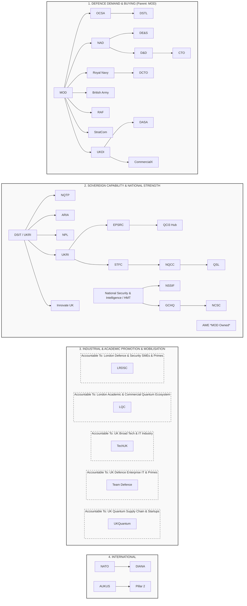

# EMERGENT_COMPUTE_ORG_MINDMAP.md

### Organizational Hierarchy & Interface

---

## 1. UK Defence Demand & Buying 
**Parent Department:** **MOD** (Ministry of Defence) - Central defence department setting national defence policy, procurement budgets, and strategic directives.

| Directorate / FLC | |  | (A) Role | (B) Tech Horizon & Focus | (C) Operating Model | (D) Strategic Value to Defence Compute |
| :--- | :--- | :--- | :--- | :--- | :--- | :--- |
| **OCSA** (Office of the Chief Scientific Adviser) | | | Directs defence science, technology, and strategic research priorities. | **Horizon:** All Horizons **Focus:** Broad Tech & Science | S&T Strategy & Cross-Gov Alignment | Identifies algorithmic gaps; aligns defence S&T investment with national science policy. |
| | **DSTL** (Defence Science and Technology Laboratory) | | In-house technical authority delivering sovereign defence R&D, red-teaming, and evaluation. | **Horizon:** Foundational to Agile **Focus:** Broad Tech & Compute | Research, Technical Assurance, Prototyping | Core sovereign evaluator of algorithmic claims; benchmarks military utility and defense-specific algorithmic IP. |
| **NAD** (National Armaments Director) | | | Directs defence procurement, capability acquisition programmes, and industrial strategy. | **Horizon:** BAU / Near-Term **Focus:** Broad Tech (Hardware & Platforms) | Commercial Procurement & Capability Delivery | Establishes formal acquisition pathways to transition mature algorithms into major defence capability. |
| | **DE&S** (Defence Equipment & Support) | | Traditional procurement delivery agency managing bulk contracting and equipment support. | **Horizon:** BAU / Near-Term **Focus:** Hardware / Platform Heavy | Standard Procurement | Manages bulk contracting (though emergent algorithmic compute is more likely to flow via D&D). |
| | **D&D** (Digital & Data) | | Delivers defence digital capability, enterprise software, and integration. | **Horizon:** BAU / Near-Term **Focus:** Algorithmic Compute & Enterprise IT | Enterprise Service & Capability Delivery | Defines integration pipelines and APIs required to embed algorithmic solvers into MOD's digital backbone. |
| | | **CTO** (Chief Technology Office) | Owns defence digital architecture, data standards, enterprise software, and integration. | **Horizon:** BAU / Near-Term **Focus:** Algorithmic Compute & Enterprise IT | Enterprise Architecture & Standards | Ensures technological coherence across defence, assessing algorithmic readiness and enterprise fit. |
| **Royal Navy** | | | Maritime Front Line Command operating surface, sub-surface, and fleet air arm forces. | **Horizon:** BAU / Near-Term **Focus:** Algorithmic Compute & Maritime Ops | Operational Buying | Drives demand for near-term maritime algorithmic routing, autonomous swarm logic, and sensor fusion. |
| | **DCTO** (Disruptive Capabilities and Technologies Office) | | Navy innovation unit pulling disruptive tech into maritime trials. | **Horizon:** Agile Prototyping **Focus:** Broad Tech & Emerging Compute | Challenge Funding & Prototyping | Accelerates maritime algorithmic capabilities from SME labs into at-sea trials. |
| **British Army** | | | Land Front Line Command. | **Horizon:** BAU / Near-Term **Focus:** Algorithmic Compute & Land Ops | Operational Buying | End-user for land-based tactical optimization, logistics routing, and edge AI algorithms. |
| **RAF** (Royal Air Force) | | | Air and Space Front Line Command. | **Horizon:** BAU / Near-Term **Focus:** Algorithmic Compute & Air Ops | Operational Buying | End-user for aerospace platform optimization, radar data processing, and flight routing algorithms. |
| **StratCom** (Strategic Command) | | | Joint Front Line Command managing cyber, intelligence, special forces, and joint integration. | **Horizon:** BAU / Near-Term **Focus:** Algorithmic Compute, Cyber & Intel | Operational Buying | Principal driver for joint, multi-domain algorithmic intelligence, cryptography, and cyber capabilities. |
| **UKDI** (UK Defence Innovation) | | | MOD innovation funding umbrella accelerating disruptive technologies from TRL 3 to 7. | **Horizon:** Agile Prototyping **Focus:** Broad Tech & Innovation | Challenge Funding & Rapid Pull-Through | Solicits and funds high-risk algorithmic solver challenges targeting specific operational defence bottlenecks. |
| | **DASA** (Defence and Security Accelerator) | | Finds and funds exploitable innovation to support UK defence and security quickly. | **Horizon:** Agile Prototyping **Focus:** Broad Tech & Innovation | Challenge Funding & Grants | Pulls early-stage algorithmic IP from SMEs directly into MOD proof-of-concepts. |
| | **CommercialX** | | Fast-track prototyping procurement vehicle embedded within UKDI to contract agile SME tech. | **Horizon:** Agile Prototyping **Focus:** Agile Software & Compute | Accelerated Commercial Contracts | Provides rapid commercial contracting routes to trial and inject emerging algorithmic software into defence trials. |

---

## 2. Sovereign Capability & Cross Gov
Contains national labs, councils, and investment vehicles supporting UK sovereign advantage.

| Gov Dept | |  | (A) Role | (B) Tech Horizon & Focus | (C) Operating Model | (D) Strategic Value to Defence Compute |
| :--- | :--- | :--- | :--- | :--- | :--- | :--- |
| **DSIT / UKRI** (Department for Science, Innovation and Technology + Department for Business and Trade) / (UK Research and Innovation) | | | Lead civil government department and funding agency for national science, research, and technical infrastructure. | **Horizon:** All Horizons **Focus:** Broad Tech & Science | Policy & National Research Funding | Provides foundational civil funding that builds the national talent base and compute infrastructure MOD leverages. |
| | **NQTP** (National Quantum Technologies Programme) | | £2.5bn strategic umbrella coordinating UK quantum investment across EPSRC, STFC, InnovateUK, etc. | **Horizon:** All Horizons **Focus:** Whole Sector Quantum | Strategy & Coordination | Ensures coherence across the sovereign ecosystem; not a direct delivery lab itself. |
| | **ARIA** (Advanced Research and Invention Agency) | | High-risk, high-reward independent research agency directly funding transformational tech. | **Horizon:** Foundational/Agile R&D **Focus:** Radical Leap Tech | Challenge Funding | Provides alternative, highly agile funding route for extreme-edge algorithmic compute. |
| | **EPSRC** (Engineering and Physical Sciences Research Council) | | Research council funding academic foundational science, mathematics, and discovery-stage engineering. | **Horizon:** Foundational R&D **Focus:** Wider Quantum & Math | Academic Grants & Hub Funding | Funds the fundamental mathematical algorithms, complexity theory, and basic quantum logic. |
| | | **QCI3 Hub** (Hub for QC via Integrated and Interconnected Implementations) | Oxford-led academic consortium researching integrated quantum processors, networks, and application algorithms. | **Horizon:** Foundational R&D **Focus:** QC Hardware & Physics | Multi-University Consortium | Develops next-gen quantum & hybrid algorithms and solver architectures in open collaboration. |
| | **STFC** (Science and Technology Facilities Council) | | Research council delivering large-scale national scientific facilities, HPC, and national labs. | **Horizon:** Foundational to Agile **Focus:** HPC & National Labs | Infrastructure Provision & Facilities | Provides scalable national supercomputing and testbed environments necessary to validate algorithms. |
| | **NQCC** (National Quantum Computing Centre) | | National laboratory jointly delivered by STFC and EPSRC for scaling quantum hardware and HPC testbeds. | **Horizon:** Agile Prototyping **Focus:** QC Hardware & Physics | Hardware Hosting, Access, Testbeds | Key national testbed for MOD to test algorithms on bare-metal QPUs and evaluate hardware-software co-design. |
| | | **QSL** (Quantum Software Lab) | National software facility hosted by Univ of Edinburgh in partnership with NQCC. | **Horizon:** Agile Prototyping **Focus:** Algorithmic Compute (QC) | Algorithm Verification & Software | **Directly critical to MOD competence:** Delivers formal algorithm verification, compiler efficiency, and benchmarking. |
| | **NPL** (National Physical Laboratory) | | National measurement standard laboratory holding sovereign capability in metrology, atomic timing, and PNT. | **Horizon:** Foundational to Agile **Focus:** Wider Quantum (Non-Compute) | Measurement Standards, Testing | Assures precision measurement, noise characterisation, and hardware benchmarks. |
| | **Innovate UK** | | UK innovation agency delivering grant funding and commercialisation support to scale dual-use tech businesses. | **Horizon:** Agile to BAU **Focus:** Broad Tech & Commercialisation | Matched Grants & Competitions | Drives sovereign industrial supply chain; co-funds dual-use startups developing commercial algorithmic software. |
| **National Security & Intelligence / HMT** | | | Financial and intelligence parentage overseeing venture and security-focused capabilities. | **Horizon:** All Horizons **Focus:** Economic & Cyber Security | Funding & Policy | Sets policy for retaining sovereign control over critical dual-use intellectual property and algorithms. |
| | **NSSIF** (National Security Strategic Investment Fund) | | Sovereign venture arm investing equity in dual-use technologies vital to national security. | **Horizon:** Agile to BAU **Focus:** Dual-Use Security Tech | Equity Investment & Venture Funding | Secures sovereign UK ownership and IP retention in critical emergent algorithmic and quantum security ventures. |
| | **GCHQ** (Government Communications Headquarters) | | National intelligence and security agency. | **Horizon:** Foundational to BAU **Focus:** Cryptography & AI | Classified Operations | Sovereign leader in algorithmic cryptanalysis, codebreaking, and secure data pipelines. |
| | | **NCSC** (National Cyber Security Centre) | GCHQ's public-facing cyber security authority. | **Horizon:** BAU / Near-Term **Focus:** Cyber Resilience | Policy, Standards, Advice | Sets post-quantum cryptography (PQC) standards that MOD enterprise networks must adopt. |
| **MOD** (Ministry of Defence)| | | (While part of Defence, AWE functions as a Sovereign Capability Lab for the nation). | **Horizon:** Foundational to BAU **Focus:** Sovereign Defence Compute | Policy & Funding | Sole owner of AWE, directing its capabilities toward sovereign deterrent and security needs. |
| | **AWE** (Atomic Weapons Establishment) | | MOD-owned establishment responsible for the UK's nuclear deterrent. | **Horizon:** Foundational to BAU **Focus:** Secure HPC & Simulation | Classified Research & Infrastructure | Holds sovereign HPC expertise; critical for classified simulation, material modeling, and future quantum security. |

---

## 3. Industrial & Academic Promotion & Mobilisation
Contains industry bodies, trade associations, and regional clusters representing the UK's quantum, tech, and defence supply chain.

| Accountable To / Represents | Body / Cluster / Hub | (A) Role | (B) Tech Horizon & Focus | (C) Operating Model | (D) Strategic Value to Defence Compute |
| :--- | :--- | :--- | :--- | :--- | :--- |
| *UK Quantum Supply Chain & Startups* | **UKQuantum** | Quantum sector-specific trade association representing UK quantum supply chain from startups to primes. | **Horizon:** All Horizons **Focus:** Whole Sector Quantum | Industry Advocacy & Supply Chain Mobilisation | Aggregates UK quantum vendor capabilities; gives MOD visibility of domestic algorithmic IP and hardware readiness. |
| *UK Defence Enterprise IT & Primes* | **Team Defence** (Team Defence Information) | MOD-Industry collaborative body focused on digital interoperability, secure data sharing, and supply chain standards. | **Horizon:** BAU / Near-Term **Focus:** Enterprise IT & Digital Integration | Working Groups & Interoperability Standards | Ensures future algorithmic workflows comply with defence data schemas, security architectures, and defence cloud environments. |
| *UK Broad Tech & IT Industry* | **TechUK** | Broad technology trade association representing UK digital, cloud, AI, and enterprise tech suppliers. | **Horizon:** All Horizons **Focus:** Broad Compute & AI | Policy Dialogue & Commercial Networking | Connects MOD to mainstream classical compute, HPC, and AI algorithm vendors that form the foundation for hybrid workflows. |
| *London Academic & Commercial Quantum Ecosystem* | **LQC** (London Quantum Cluster) | London-specific networking and commercialisation hub for the regional quantum tech ecosystem. | **Horizon:** Foundational to Agile **Focus:** Regional Quantum Ecosystem | Cluster Events & Networking | Fosters a concentrated talent pool and SME ecosystem, acting as a regional hub for defence to source algorithmic expertise. |
| *London Defence & Security SMEs & Primes* | **LRDSC** (London Region Defence & Security Cluster) | London/South East regional cluster driving collaboration between defence, academia, and industry. | **Horizon:** Agile to BAU **Focus:** Regional Defence SMEs | Cluster Collaboration | Connects MOD to localized deep tech, AI, and algorithmic innovators within the capital's defence base. |

---

## 4. International
Allied and cross-border initiatives supporting or interacting with UK capabilities or research.

| Parent / Alliance | Organization / Initiative | (A) Role | (B) Tech Horizon & Focus | (C) Operating Model | (D) Strategic Value to Defence Compute |
| :--- | :--- | :--- | :--- | :--- | :--- |
| **NATO** (North Atlantic Treaty Organization) | | Political and military alliance of North American and European countries. | **Horizon:** All Horizons **Focus:** Allied Defence | Allied Interoperability & Joint Funding | Enables multi-national standardisation and access to allied algorithmic & tech capabilities. |
|  | **DIANA** (Defence Innovation Accelerator for the North Atlantic) | NATO accelerator (with UK footprint) connecting dual-use deep tech innovators to defence. | **Horizon:** Agile Prototyping **Focus:** Dual-Use / Allied Tech | Allied Challenge Funding & Grants | Integrates UK algorithmic innovators into the wider NATO tech ecosystem, opening up allied IP and funding. |
| **AUKUS** (Australia, UK, US) | | Trilateral security pact focusing on the Indo-Pacific and advanced capability sharing. | **Horizon:** Foundational to Agile **Focus:** Allied Defence & Tech | Trilateral Agreements & IP Sharing | Strategic framework for jointly developing cutting-edge defence capabilities with closest allies. |
| | **Pillar 2** (Advanced Capabilities) | Trilateral R&D sharing specifically targeting Quantum, AI, and Cyber. | **Horizon:** Foundational to Agile **Focus:** Emergent Tech (Quantum/AI) | Joint Innovation Challenges & Co-Dev | Opens direct co-development pathways and pooled funding for MOD with US/AUS algorithmic tech. |
