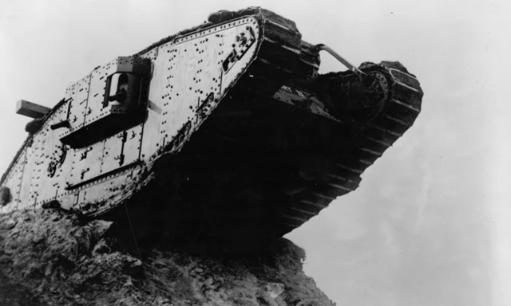
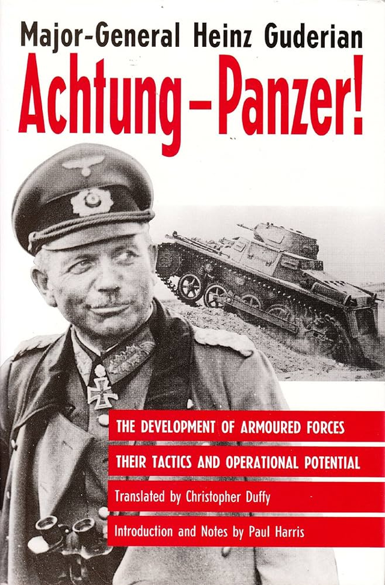
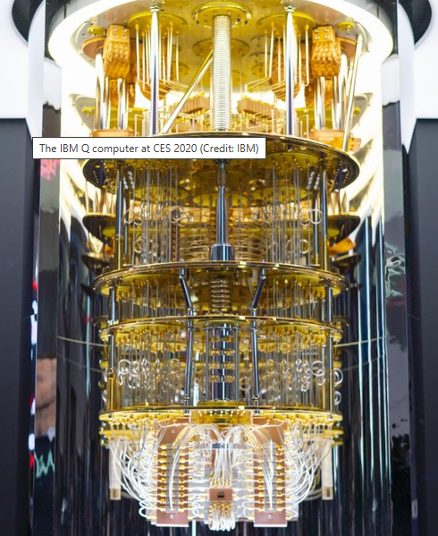
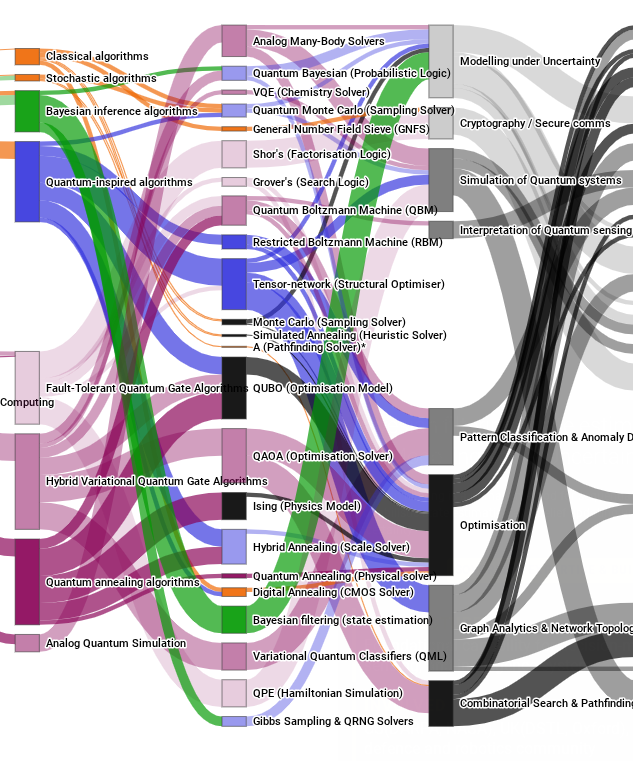

# Somme, 1916: Tanks make a questionable entrance. No wait it’s 2026: We need to talk about Quantum Computing

|  |
| --- |
| **Somme, 1916. Tanks arrive, and no one really knows what to do with them.**
Some dismiss them. Others overhype them. Most misunderstand them.
**It’s 2026. We are here again, with Quantum Computing.** |

We began in a world shaped entirely by cavalry. Range, speed, logistics, **even imagination** were bounded by what a horse could do. If a horse couldn’t solve it, it rarely became a serious question. Entire problem spaces simply didn’t exist to us.

Then tanks appeared.

They were used. Experimented with. Invested in. But early tanks were slow, unreliable, and unclear in purpose. Not obviously better. Not ready to replace anything. Which made them easy to misunderstand. Some dismissed them. Others spoke about them as if they would change everything. Both reactions came from the same place: **we did not yet understand what new kinds of problems they made possible** - including ones we would never have thought to consider before.

  

So progress was uneven. Tanks were applied within existing thinking, or isolated from it. The real shift only came when doctrine evolved—when people began to understand how tanks worked *with* other elements, how they changed tempo, coordination, and decision-making. As Heinz Guderian recognised, their impact wasn’t in the machine alone, but in how they reshaped the fight around them.

That understanding did not arrive with the technology. It took time to build. Experimentation. Failure. Iteration. And people capable of recognising patterns before they were obvious.

And that is where we are now with Quantum Computing - albeit with an important difference. Unlike tanks, which we used imperfectly while learning, we have barely begun to use quantum at all. We are observing, discussing, and waiting for clarity. But the understanding we need will not arrive fully formed with mature systems - it has to be built ahead of them.

Because this is not ultimately about quantum.

  

It is about **algorithms as a technology domain in their own right**- the ability to model problems, structure them, and solve them independently of any single machine. To recognise which problems belong to which kind of computational approach -classical, quantum, probabilistic, neuromorphic - and how those choices change outcomes. AI was a clear signal of this shift. Quantum will accelerate it.

That is a capability we do not currently have at the level required.

And it is exactly this capability that determines whether new computational approaches and algorithms are exploited early, misapplied and abandoned, or only understood after advantage has already been lost.

Recent conflict has made this clear. The advantage no longer sits with those who simply possess advanced systems, but with those who can adapt, combine, and reuse both technologies and the algorithms that run on them faster than their opponent.

If we do not build competence in this algorithmic domain now - alongside the mathematics and problem-formulation skills that underpin it - we will not just struggle to adopt quantum computing.

We will struggle to exploit the new classes of algorithms that emerge around it. We will continue to see them arrive, talk about them, and still lack the doctrine to use them effectively.

|  |
| --- |
| Tanks did not just improve cavalry. They enabled entirely new forms of manoeuvre, coordination, and tempo that were invisible to a cavalry mindset. Quantum computing will do the same - not by replacing existing approaches, but by opening problem spaces we are not yet equipped to recognise: making decisions under uncertainty, coordinating complex operations at scale, understanding how actions play out across a contested battlespace, and identifying options that would never be visible through current planning methods - **particularly to those who learn to see them first**.And as with tanks, the constraint will not be the technology.It will be whether we have built the understanding in time to use it. |
